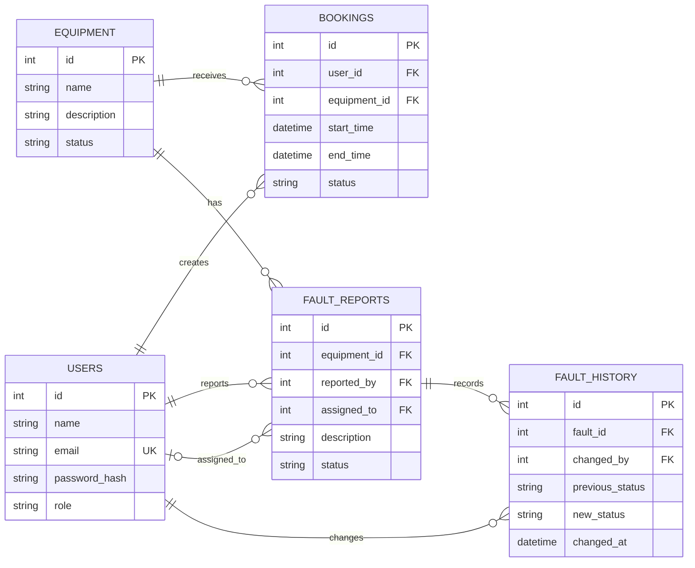
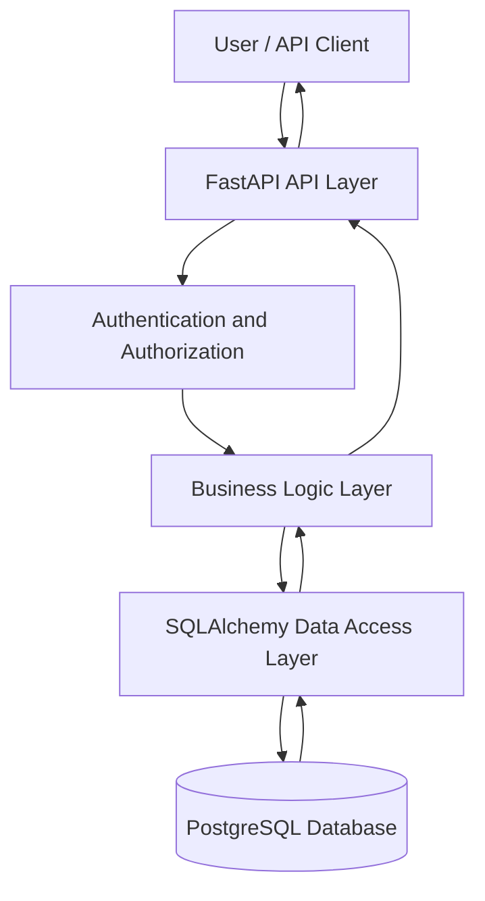

# LabOps — System Design

## 1. Database Design

LabOps will use PostgreSQL as its relational database. The database will initially contain five tables: `users`, `equipment`, `bookings`, `fault_reports`, and `fault_history`.

### 1.1 Users

Stores the people registered in the system.

- `id`: Primary key identifying each user.
- `name`: User's name.
- `email`: Unique email address.
- `password_hash`: Hashed password, never the plaintext password.
- `role`: User role — student, technician, or admin.

### 1.2 Equipment

Stores laboratory equipment and its current status.

- `id`: Primary key identifying each equipment record.
- `name`: Equipment name.
- `description`: Brief description.
- `status`: Current status, such as available or under repair.

### 1.3 Bookings

Stores equipment reservations.

- `id`: Primary key identifying each booking.
- `user_id`: Foreign key referencing `users.id`.
- `equipment_id`: Foreign key referencing `equipment.id`.
- `start_time`: Booking start time.
- `end_time`: Booking end time.
- `status`: Booking status — confirmed or cancelled.

### 1.4 Fault Reports

Stores equipment problems reported by users.

- `id`: Primary key identifying each fault report.
- `equipment_id`: Foreign key referencing `equipment.id`.
- `reported_by`: Foreign key referencing `users.id`.
- `assigned_to`: Nullable foreign key referencing `users.id` for the assigned technician.
- `description`: Description of the problem.
- `status`: Current fault status.

### 1.5 Fault History

Stores the history of fault status changes.

- `id`: Primary key identifying each history record.
- `fault_id`: Foreign key referencing `fault_reports.id`.
- `previous_status`: Status before the change.
- `new_status`: Status after the change.
- `changed_by`: Foreign key referencing `users.id`.
- `changed_at`: Timestamp of the change.

## 2. Relationships

- One user can create multiple bookings.
- One equipment record can be associated with multiple bookings over time.
- One equipment record can have multiple fault reports.
- One fault report can have multiple history records.
- One technician can be assigned multiple fault reports.

## 3. Database Integrity

The database will enforce primary keys, foreign keys, unique user email addresses, and appropriate required fields.

Booking validation will prevent invalid time ranges and overlapping active bookings for the same equipment. Adjacent bookings will be allowed, and cancelled bookings will not block availability.

Equipment marked as under repair will not accept new bookings. Fault status changes and their history records will be stored so that changes can be traced.

All booking timestamps will be timezone-aware and handled consistently in UTC.

## 4. Entity-Relationship Diagram

The following diagram illustrates the database tables, their key fields, and the relationships between them.

## 5. System Architecture

LabOps will use a layered backend architecture. FastAPI will expose REST API endpoints, the business logic layer will enforce application rules, SQLAlchemy will handle database interactions, and PostgreSQL will store persistent data.

The API will initially be tested and demonstrated using FastAPI's interactive `/docs` interface rather than a separate frontend application.

### Responsibilities of Each Layer

- **API layer:** Exposes endpoints for equipment, bookings, and fault reports.
- **Authentication and authorization:** Identifies users and restricts actions according to their roles.
- **Business logic layer:** Validates requests, enforces booking rules, and controls fault status transitions.
- **Data access layer:** Uses SQLAlchemy to interact with database records.
- **Database layer:** PostgreSQL stores users, equipment, bookings, fault reports, and fault history.